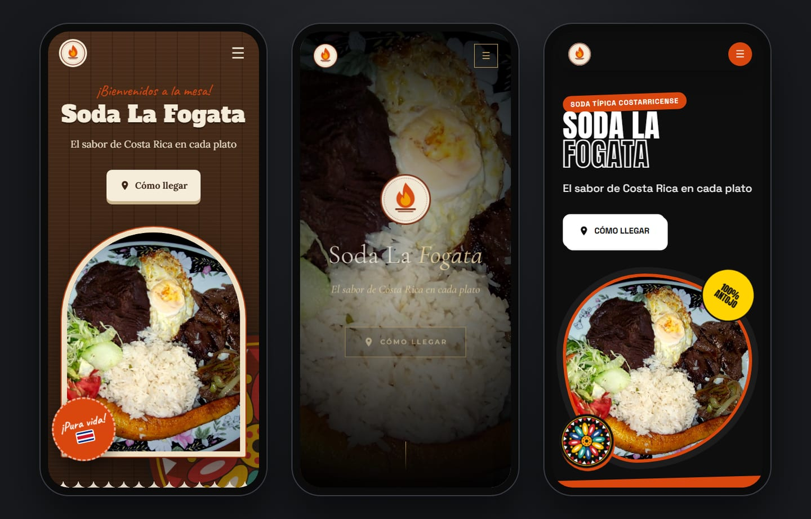
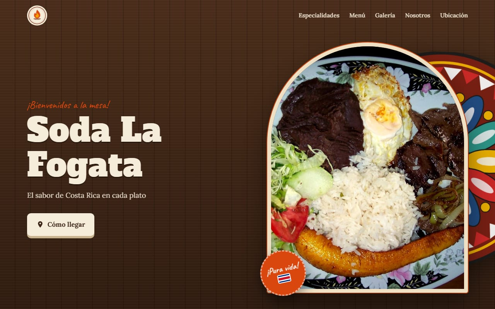
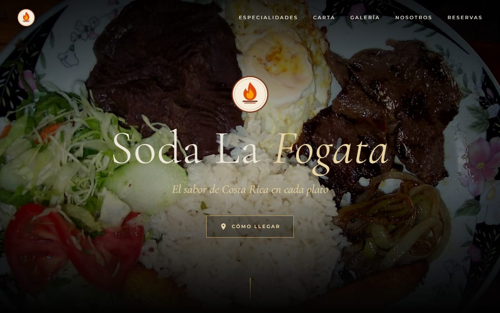
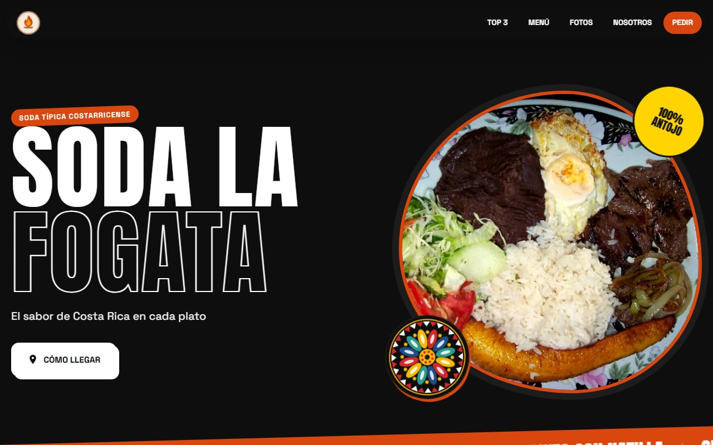
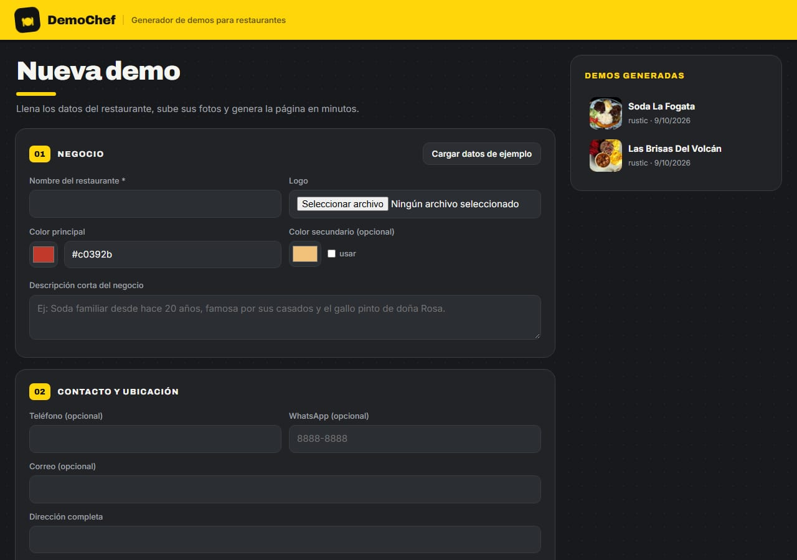
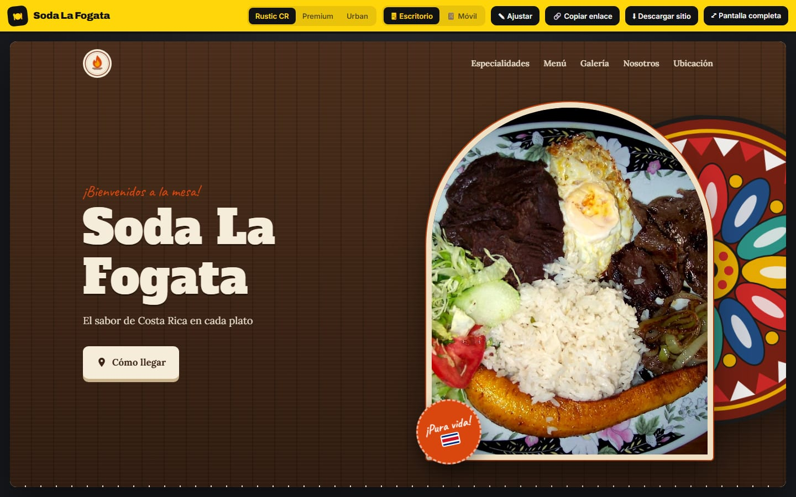

# 🍽 DemoChef — Generador de demos web para restaurantes

Herramienta para crear, en minutos, una demostración comercial de la página web de un restaurante a partir de sus fotos, su menú y su logo. Tres plantillas con estilos completamente distintos, toque costarricense y diseño *mobile first*. **Todo funciona gratis y en local.**

### 👉 [Ver la demo en vivo](https://juanc67811.github.io/demochef/)

<p align="center"></p>

| Rustic CR | Premium Dining | Urban Food |
|---|---|---|
| [](https://juanc67811.github.io/demochef/rustic/) | [](https://juanc67811.github.io/demochef/premium/) | [](https://juanc67811.github.io/demochef/urban/) |
| Sodas, comida típica, casados | Parrillas, marisquerías, gourmet | Hamburguesas, pizzerías, food trucks |

**El panel de trabajo:** formulario de datos y pantalla de presentación, con cambio de plantilla en vivo y vista de celular.

<p align="center"> </p>

## Qué hace
- **Análisis de fotos:** puntúa nitidez, luz, contraste, color y encuadre, y elige automáticamente las 3 especialidades de la casa.
- **Retoque gastronómico local** con `sharp`: tonos cálidos, viveza, contraste, nitidez y viñeta.
- **Paleta desde el logo:** la página toma los colores del negocio.
- **Toque tico** dibujado en SVG: rueda de carreta de Sarchí, hoja de plátano, chorreador y mantel típico.
- **Textos automáticos** (eslogan y "Sobre nosotros") e **instrucciones especiales** en español ("Horario: …", "Ocultar la galería", "Más elegante"…).
- **Reservaciones por WhatsApp** y **buscador del menú**.
- **Exportación a ZIP** lista para publicar gratis.

Stack: Node.js, Express, sharp. Sin frameworks de frontend ni dependencias de pago.

## Uso
```
npm install
npm start          # http://localhost:4321
```
1. Llenar el formulario (nombre, logo, colores, contacto, ubicación, redes, fotos, menú).
2. **Generar demo**: analiza las fotos, elige las 3 mejores comidas como *Especialidades*, las retoca y arma la web.
3. En la pantalla de presentación: cambiar plantilla en vivo (Rustic CR / Premium / Urban), vista móvil o escritorio, ajustar textos y copiar el enlace.

## IA (opcional, recomendado)
Copiar `.env.example` a `.env` y completar las claves:
- `ANTHROPIC_API_KEY` (**Claude**): clasifica cada foto, puntúa qué tan apetitosa es, nombra los platillos, escribe eslogan y "Sobre nosotros", y escribe la **dirección de arte** (fondo y utilería) de cada foto de comida.
- `GEMINI_API_KEY` (**Gemini, edición de imágenes**): rehace las fotos de comida y bebida siguiendo esa dirección de arte: la misma comida, pero con luz profesional y un fondo acorde (costarricense si es comida típica). Claude no genera imágenes, por eso este paso usa Gemini. Las originales se conservan y en la presentación hay un botón para alternar **Fotos IA / Originales**.

Sin claves: puntaje local (nitidez, luz, contraste, color, encuadre), retoque local con `sharp` y textos a partir de la descripción.

## Colores y contacto
- Con logo, la página usa automáticamente sus 2 colores principales (casilla "Usar los colores del logo").
- Teléfono y WhatsApp son opcionales: si no hay WhatsApp, los botones pasan a "Llamar"; si no hay ninguno, se ocultan.

## Funciones interactivas (gratis)
- 📅 **Reservaciones**: fecha, hora, personas y nota, enviado por WhatsApp.
- 🔍 **Buscador del menú** (con más de 5 platillos).
Se activan o desactivan en el formulario o en "Ajustar". Las reservas requieren WhatsApp.

## Guardar y publicar
- Las demos se guardan solas en `data/` y aparecen en la lista (🗑 para eliminar).
- **⬇ Descargar sitio** (en la presentación) genera un ZIP con `index.html` + imágenes. Descomprimir y arrastrar la carpeta a https://app.netlify.com/drop para tener un enlace público gratis que mandarle al cliente.

## Instrucciones especiales
Al final del formulario (y en "Ajustar" de la presentación) se escriben pedidos del cliente o propios, uno por línea. Gratis, interpretados con reglas en español:
- `Horario: ...` · `Plato del día: ...` · `Aviso: ...` (banda destacada bajo la portada)
- `Eslogan: ...` · `Agregar en nosotros: ...` · `El botón que diga ...`
- `Ocultar la galería` (también menú, especialidades, nosotros, ubicación)
- `Color principal verde` / `Color secundario dorado` / `#hex`
- `Que se vea más elegante` / `más moderno` / `más tradicional` (cambia plantilla)
- `Sin adornos ticos` / `Más tico`

Lo que no entienda se muestra aparte. Si [Ollama](https://ollama.com) (IA local gratuita) está instalado y corriendo, se usa automáticamente para frases libres.

## Estructura
- `server.js`: API y rutas (`/` formulario, `/p/:slug` presentación, `/demo/:slug?t=plantilla` la web)
- `lib/images.js`: análisis de calidad y retoque · `lib/ai.js`: Claude visión · `lib/instructions.js`: instrucciones especiales · `lib/imagegen.js`: fotos con IA (Gemini) · `lib/copy.js`: textos de respaldo
- `templates/`: `rustic.js`, `premium.js`, `urban.js` + `common.js`
- `data/<slug>/`: cada demo (demo.json + imágenes optimizadas en webp)
- `docs/`: demo en vivo publicada con GitHub Pages ("Soda La Fogata", restaurante ficticio)

## Créditos de fotografías
Las fotos de la demo en vivo provienen de Wikimedia Commons bajo licencias libres y fueron retocadas por DemoChef. Las versiones retocadas de fotos CC BY-SA se comparten bajo la misma licencia. "Soda La Fogata" es un negocio ficticio; el logo es original de este proyecto.

| Platillo en la demo | Archivo original | Autor | Licencia |
|---|---|---|---|
| Casado con bistec | [Casado Tico.jpg](https://commons.wikimedia.org/wiki/File:Casado_Tico.jpg) | Richie Diesterheft from Chicago, IL, USA | [CC BY 2.0](https://creativecommons.org/licenses/by/2.0) |
| Plato típico con queso frito | [Casado con Carne de Ternero, Sacramento, Heredia, Costa Rica.JPG](https://commons.wikimedia.org/wiki/File:Casado_con_Carne_de_Ternero,_Sacramento,_Heredia,_Costa_Rica.JPG) | Victor Quirós A | [CC BY-SA 3.0](https://creativecommons.org/licenses/by-sa/3.0) |
| Casado con pollo empanizado | [Casado meal at Cristal soda restaurant.jpg](https://commons.wikimedia.org/wiki/File:Casado_meal_at_Cristal_soda_restaurant.jpg) | Spideog | [CC BY-SA 4.0](https://creativecommons.org/licenses/by-sa/4.0) |
| Gallo pinto con natilla | [Costa Rican Gallo Pinto.jpg](https://commons.wikimedia.org/wiki/File:Costa_Rican_Gallo_Pinto.jpg) | Legendre17 | [CC BY 3.0](https://creativecommons.org/licenses/by/3.0) |
| Chifrijo | [Chifrijo.jpg](https://commons.wikimedia.org/wiki/File:Chifrijo.jpg) | Roberto Rodríguez | [CC BY-SA 2.0](https://creativecommons.org/licenses/by-sa/2.0) |
| Olla de carne | [Olla de carne.jpg](https://commons.wikimedia.org/wiki/File:Olla_de_carne.jpg) | Rodtico21 | [CC BY-SA 3.0](https://creativecommons.org/licenses/by-sa/3.0) |
| Patacones | [Patacones.JPG](https://commons.wikimedia.org/wiki/File:Patacones.JPG) | Jdvillalobos | [CC BY-SA 3.0](https://creativecommons.org/licenses/by-sa/3.0) |
| Ceviche de pescado | [Ceviche.jpg](https://commons.wikimedia.org/wiki/File:Ceviche.jpg) | Micah MacAllen | [CC BY-SA 2.0](https://creativecommons.org/licenses/by-sa/2.0) |
| Tres leches | [Torta de tres leches 2.jpg](https://commons.wikimedia.org/wiki/File:Torta_de_tres_leches_2.jpg) | Muago | [CC0](http://creativecommons.org/publicdomain/zero/1.0/deed.en) |
| Café chorreado | [Chorreador.jpg](https://commons.wikimedia.org/wiki/File:Chorreador.jpg) | Sharalds | Public domain |
